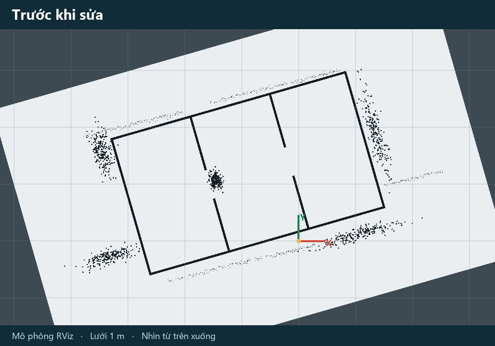
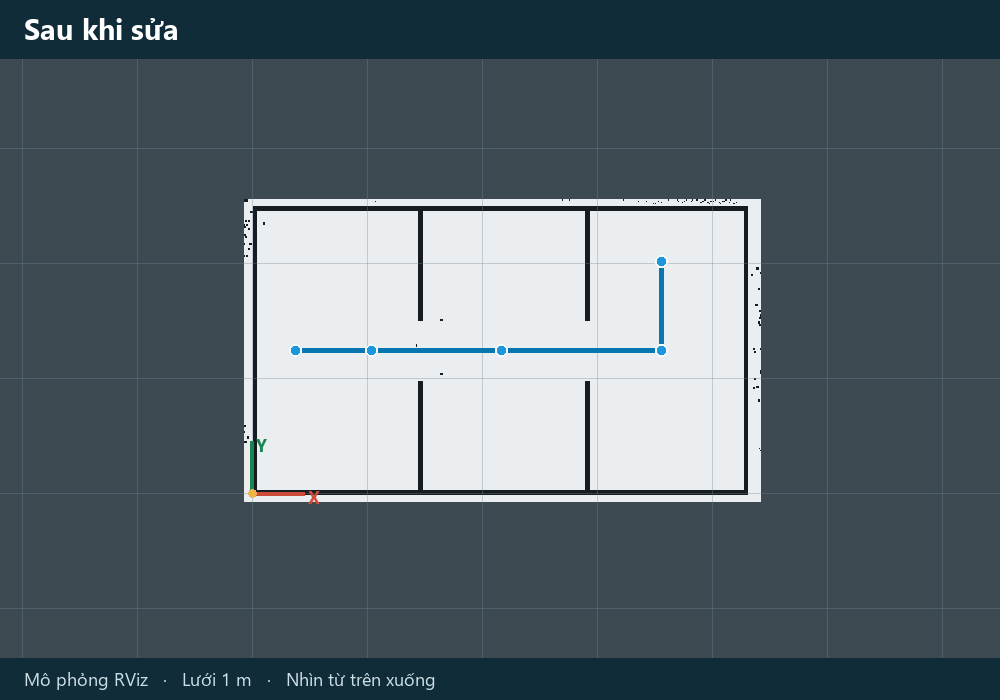

# Map Topo Editor

Ứng dụng desktop Python để chỉnh sửa bản đồ ROS dạng YAML/PGM, đặt gốc tọa độ, làm sạch vùng quét và tạo đồ thị node có hướng. Bản đồ và topo có thể lưu thành ZIP để tiếp tục chỉnh sửa.

## Demo

https://github.com/user-attachments/assets/ee27abe2-df1c-4366-8e2a-fc776c371a96

| Trước khi chỉnh sửa | Sau khi chỉnh sửa |
| --- | --- |
|  |  |

## Chạy trên Windows

Cài Python 3 có Tkinter. Tải hoặc clone mã nguồn, rồi mở PowerShell trong thư mục chứa `app.py` và chạy:

```powershell
py -m venv .venv
.\.venv\Scripts\python.exe -m pip install -r requirements.txt
.\.venv\Scripts\python.exe app.py
```

## Chạy trên Ubuntu

Mở terminal trong thư mục chứa `app.py` và chạy:

```bash
sudo apt install python3-tk python3-venv
python3 -m venv .venv
.venv/bin/python -m pip install -r requirements.txt
.venv/bin/python app.py
```

## 1. Mở bản đồ

Để bắt đầu từ bản đồ ROS, đặt ảnh PGM (P2 hoặc P5) cạnh file YAML rồi bấm **Mở YAML…**. Ví dụ, nếu ảnh tên là `kho.pgm`, file `kho.yaml` có thể chứa:

```yaml
image: ./kho.pgm
resolution: 0.05
origin: [-4.0, -2.5, 0.0]
negate: 0
occupied_thresh: 0.65
free_thresh: 0.196
```

`resolution: 0.05` nghĩa là mỗi pixel ứng với 5 cm. Hai số đầu của `origin` là tọa độ gốc ảnh theo mét, số thứ ba là góc xoay theo radian. Dùng thông số của bản đồ thực tế. Nếu đường dẫn ảnh trong YAML đã cũ, app tìm ảnh cùng tên cạnh YAML và cho phép chọn PGM thủ công.

Mở YAML sẽ tạo một topo trống. Để tiếp tục công việc đã lưu, chọn **Mở ZIP…** rồi mở gói bản đồ do editor xuất.

## 2. Quan sát và chỉnh sửa

Khung vàng bao toàn bộ kích thước ảnh. Các pixel đen của PGM hiện thành điểm tối trên nền trắng. Đưa chuột lên ảnh để đọc tọa độ thế giới theo mm. Kéo chuột phải để dịch góc nhìn, cuộn để zoom tại con trỏ, hoặc bấm **Vừa khung** để xem toàn bản đồ.

Bấm **Xoay / tịnh tiến**, **Xóa vùng** hoặc **Topo** để mở nhóm công cụ tương ứng. Trong mỗi nhóm, **✓ Áp dụng** giữ thay đổi trong phiên làm việc. **✕ Hủy** hoặc **Esc** hoàn tác các thao tác kể từ lúc mở nhóm đó. Cuối phiên, dùng **Xuất ZIP…** để ghi ra đĩa.

### Căn tường và đặt gốc ở một góc phòng

1. Mở **Xoay / tịnh tiến**. Gốc thế giới `(0, 0)` được ghim giữa màn hình. Nhập **Bước xoay (°)**, ví dụ `1`, rồi bấm **↶** hoặc **↷** đến khi tường song song với trục ngang hoặc dọc. Giảm bước xuống `0.1` để chỉnh tinh.
2. Chọn **Đặt gốc**, rồi bấm đúng góc tường muốn dùng làm `(0, 0)`. Điểm này sẽ chuyển về tâm. Nếu cần dịch thêm một khoảng xác định, nhập **Bước dịch (m)** rồi dùng **← → ↑ ↓**. Ví dụ, bước `0.10` dịch bản đồ 10 cm mỗi lần bấm.
3. Bấm **✓ Áp dụng**. Phép xoay và độ dời được lưu vào YAML khi xuất ZIP. Các node hiện có đi theo bản đồ. Khi thoát nhóm, app khôi phục góc nhìn trước đó.

### Làm sạch nhiễu bằng Xóa vùng

1. Mở **Xóa vùng**, chọn **Đa giác** hoặc **Chữ nhật**, rồi bấm **Bắt đầu chọn**.
2. Với **Đa giác**, bấm chuột trái để thêm từng đỉnh. Cần ít nhất ba đỉnh khác nhau tạo thành vùng có diện tích. Bấm chuột phải tại chỗ để khép vùng. Với **Chữ nhật**, giữ chuột trái tại một góc, kéo tới góc đối diện rồi thả.
3. Kiểm tra đường viền. Để dọn một cụm nhiễu trong lối đi, khoanh cụm đó rồi bấm **Xóa trong**. Toàn bộ ô trong vùng trở thành ô trống (*free*), kể cả ô chưa xác định. Để giữ mặt bằng và bỏ các vệt quét quanh nó, khoanh phần cần giữ rồi bấm **Xóa ngoài**. Các pixel bên ngoài nhận giá trị xám 205. Hai thao tác giữ kích thước ảnh và các node hiện có.
4. Sau mỗi lượt xóa, có thể vẽ ngay vùng kế tiếp. Nếu vẽ sai đường viền, bấm **Hủy vùng** rồi **Bắt đầu chọn** lại. **Hủy vùng** chỉ bỏ vùng đang vẽ. Để hoàn tác cả những lượt đã xóa trong nhóm, bấm **✕ Hủy**. Khi đã hài lòng với kết quả, bấm **✓ Áp dụng**.

### Đặt node và tạo tuyến di chuyển

1. Mở **Topo → Thêm node**. Di chuột trên bản đồ để xem tọa độ dự kiến, rồi bấm trái để đặt node. Khi cách hàng hoặc cột của node khác trong phạm vi 8 pixel màn hình, đường gióng tương ứng chuyển sang nét xanh liền. Bấm để đặt đúng tại giao điểm hiển thị.
2. Trong **Chọn / di chuyển**, bấm một node để xem đường gióng và kéo nó đến vị trí mới. Để nhập tọa độ chính xác, chọn node rồi bấm **Sửa X/Y…** hoặc bấm đúp hàng tương ứng trong bảng bên phải. X và Y là số nguyên theo mm. ID node cũng nằm trong bảng này.
3. Chọn **Nối node**, bấm node nguồn rồi bấm node đích. Bật **Nối hai chiều** để tạo cạnh đi và về. Bỏ chọn nếu tuyến chỉ cho đi một chiều. Ví dụ, để tạo tuyến A → B → C, bấm A rồi B cho đoạn đầu, sau đó bấm B rồi C cho đoạn tiếp theo.
4. Muốn xóa một chiều đi, chọn node nguồn, chọn cạnh trong danh sách cạnh đi ra, rồi bấm **Xóa cạnh**. **Xóa node** sẽ xóa cả các cạnh nối với node đó. Bấm **✓ Áp dụng** khi hoàn tất chỉnh topo.

## 3. Lưu và kiểm tra kết quả

Bấm **Xuất ZIP…**, đặt tên chẳng hạn `kho_a.zip`, rồi chọn nơi lưu. Gói chứa `kho_a.pgm` và `kho_a.yaml` cho bản đồ, `topo.json` cho node/cạnh, `compress/compress.json` cho dữ liệu topo rút gọn và `kho_a.jpg` để xem trước ảnh. Để kiểm tra, mở lại ZIP, đối chiếu gốc tọa độ, vùng vừa làm sạch, số node và chiều của các cạnh.

| Tình huống | Cách xử lý |
| --- | --- |
| Nút xuất ZIP đang mờ | Mở bản đồ và kết thúc nhóm chỉnh sửa bằng **✓ Áp dụng** hoặc **✕ Hủy**. |
| Nút **Xóa trong** hoặc **Xóa ngoài** đang mờ | Bấm **Bắt đầu chọn**, sau đó khép đa giác bằng chuột phải hoặc thả chuột để hoàn tất chữ nhật. |
| Đã thêm node nhưng khi mở lại chỉ thấy ảnh | Mở gói ZIP đã xuất bằng **Mở ZIP…**. File YAML chứa thông số bản đồ, còn node và cạnh nằm trong `topo.json` của ZIP. |

## Công cụ xuất TXT

Chạy `.\.venv\Scripts\python.exe convert.py` trên Windows hoặc `.venv/bin/python convert.py` trên Ubuntu. Chọn YAML, chọn đường dẫn TXT và bấm **Xuất TXT**. Mỗi pixel đen sinh một dòng `X Y 0 0 0`, trong đó X/Y tính bằng mét. Nếu muốn chuyển bản đồ vừa chỉnh sửa, giải nén ZIP rồi chọn YAML bên trong. Công cụ TXT tính theo độ phân giải và độ dời gốc, bỏ qua góc yaw.
